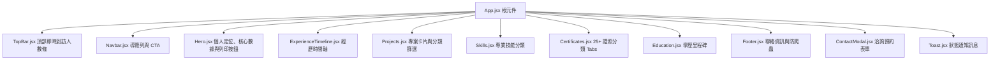

# 個人線上 CV 規格與規劃書 (Project Plan & Specification)

---

## 一、 專案概況與目標 (Project Overview)
* **目標人物**：陳富國 博士（智慧科技與資訊系統專家 / 弘光科技大學副主任・助理教授）
* **專案目標**：打造具備現代科技感、高專業度、響應式（RWD）且具備高轉換率 CTA 的個人線上履歷網站。
* **技術架構**：採用 **React** 進行組件化實作（Vite + React + Tailwind CSS），提升狀態管理與互動體驗。
* **資料來源**：[`cv-data.md`](file:///e:/全端學分班/personalCV/cv-data.md)
* **風格規範**：[`style.md`](file:///e:/全端學分班/personalCV/style.md)
* **主要素材**：`images/fgchen-croped.png`（大頭照）

---

## 二、 視覺設計與品牌規範 (Visual & Style Guide)

### 1. 樣式框架與排版
* **前端框架**：React（模組化元件開發、狀態管理）。
* **CSS 框架**：Tailwind CSS（支援 RWD 行動裝置與桌面螢幕自適應）。
* **中文字體**：Google Fonts `Chiron GoRound TC`（昭源黑體 / 圓體）。
* **圖示庫**：Font Awesome (React Icons 或 CDN)。

### 2. 色彩計畫 (Color Palette)
| 色彩角色 | 色碼 (HEX) | 使用情境與代表意義 |
| :--- | :--- | :--- |
| **主色 (Primary)** | `#005689` | 導覽列 (Navbar)、主標題、時間軸核心節點、專業沉穩底色 |
| **次色 (Secondary)** | `#007cb9` | 次標題、卡片裝飾、Icon 背景底色、Hover 狀態 |
| **淺底色 (Surface)** | `#d5eeff` | Hero 背景漸層、卡片淺底、統計數據框底色、柔和科技感 |
| **強調色 (Accent)** | `#ff895d` | **核心 CTA 按鈕**、關鍵標籤 (Badge)、吸引點擊的亮橘焦點 |

---

## 三、 開頭頂部列 / 導覽列即時到訪人數 (Real-time Visitor Counter)

### 1. 介面視覺與位置 (Top Bar / Navbar)
* **展示位置**：網站最頂端通知列（Top Bar）或整合於導覽列（Navbar）左上方。
* **視覺元素**：
  * **連線指示燈**：綠色呼吸燈（`animate-pulse`），營造實時連線科技感。
  * **計數呈現**：`🟢 即時連動 ｜ 累計造訪：1,248 人次`。
  * **動態跳動效果 (Count-up Animation)**：載入或數據更新時平滑滾動，並閃爍 Accent 橘色高亮。
* **冷啟動體驗（Skeleton 骨架屏）**：
  * 面對 GAS 的 1~3 秒冷啟動，未取得最新數值前顯示優雅的骨架動畫或預設快取值，避免版面跳動或空白。

### 2. 運作機制、防重複與配額節流策略
1. **防重複累加 (Session Guard)**：
   * 進入頁面時檢查 `sessionStorage`：
     * **同一分頁首次造訪**：發送 `?action=increment` 累加並寫入 Google Sheet。
     * **重新整理網頁**：發送 `?action=get_only` 僅讀取最新數字，不重複刷數。
2. **休眠節流 (Page Visibility API)**：
   * 背景每 30 秒進行一次 Interval Polling。
   * 當使用者切換至其他分頁或視窗縮小（`document.visibilityState === 'hidden'`）時，**自動暫停輪詢**，避免白白浪費 Google 每日 API 執行配額。

---

## 四、 CTA（行動呼籲）規劃 (Call To Action Strategy)

### 1. 目標受眾與情境
* **學校／學術機構**：邀約專題演講、學術評審、研討會講座。
* **企業／業界主管**：洽談產學合作、技術顧問（物聯網、AI 應用、Web 系統）。
* **學生／家長**：專題指導諮詢、升學與實驗室交流。
* **審查委員／人資**：一鍵預覽與列印/下載正式完整 PDF 履歷。

### 2. CTA 觸發點佈局
1. **Hero Section（主視覺首頁）**：
   * 主按鈕：`[ 邀請演講 / 合作洽詢 ]`（Accent 珊瑚橘，點擊開啟 Modal）。
   * 次按鈕：`[ 列印 / 下載完整履歷 ]`（喚起列印友善模式）與 `[ 瀏覽專案作品 ]`。
2. **導覽列（Navbar 右側）**：
   * 吸頂常駐按鈕：`[ 聯絡洽詢 ]`，隨時可發起互動。
3. **專案區塊底部（Contextual CTA）**：
   * 文案：「有專案開發或顧問諮詢需求？立即與我聯繫」。
4. **手機版浮動按鈕（FAB - Floating Action Button）**：
   * 螢幕右下角懸浮按鈕，單手操作即時喚出 Modal 表單。

---

## 五、 互動表單（Modal 彈跳視窗）與後端架構

### 1. 表單欄位規劃
| 欄位名稱 | 類型 | 屬性 | 說明 |
| :--- | :--- | :--- | :--- |
| **您的姓名 / 稱謂** | `text` | 必填 | 訪客聯絡姓名 |
| **單位 / 公司 / 學校** | `text` | 必填 | 訪客所屬機構 |
| **電子郵件 (Email)** | `email` | 必填 | 主要聯絡回覆管道 |
| **聯絡電話 / LINE ID** | `text` | 選填 | 方便即時通訊聯繫 |
| **洽詢類型** | `select` | 必填 | 演講開課 / 產學合作 / 技術顧問 / 專題指導 / 其他 |
| **洽詢主旨 / 需求內容** | `textarea` | 必填 | 預計時間、主題或合作背景說明 |
| **hp_website (蜜罐欄位)** | `text` | 隱藏 | **Anti-Spam 蜜罐**，人類看不到；爬蟲若填入則自動丟棄 |

### 2. 後端架構：Google Sheet + Google Apps Script (GAS) 雙向整合
* **資料表結構（Google Sheet 試算表）**：
  * **工作表 1：`Stats`**：記錄到訪總人數（`A1: TotalVisits`，`B1: 數值`）。
  * **工作表 2：`Inquiries`**：儲存洽詢記錄（提交時間、姓名、單位、信箱、電話、類型、內容）。
* **即時 Gmail 通知**：
  * 訪客送出表單後，GAS 會**自動發信到老師的信箱（`fgchen@gmail.com`）**，確保零時差收到演講與合作邀約。
  * 同時可寄發確認感謝信給訪客（`"已收到您的邀約，陳富國博士將儘速與您聯繫"`）。
* **前端互動體驗細節**：
  * 點擊右上角 `✕`、背景遮罩、或鍵盤 `Esc` 關閉。
  * 開啟 Modal 時鎖定背景滾動（`overflow: hidden`）。
  * 表單驗證、按鈕 Loading 狀態、送出後 Toast 訊息。

### 3. GAS 後端程式碼完整範本（支援到訪計數、表單寫入、蜜罐過濾與 Email 自動通知）
```javascript
// Google Apps Script 後端腳本
var SPREADSHEET = SpreadsheetApp.getActiveSpreadsheet();
var NOTIFY_EMAIL = "fgchen@gmail.com"; // 接收通知的信箱

// 1. GET 請求：處理到訪人數讀取與累加
function doGet(e) {
  var action = (e && e.parameter && e.parameter.action) || "increment";
  var statsSheet = SPREADSHEET.getSheetByName("Stats");
  if (!statsSheet) {
    statsSheet = SPREADSHEET.insertSheet("Stats");
    statsSheet.getRange("A1").setValue("TotalVisits");
    statsSheet.getRange("B1").setValue(0);
  }
  
  var currentVisits = Number(statsSheet.getRange("B1").getValue()) || 0;
  
  if (action === "increment") {
    currentVisits += 1;
    statsSheet.getRange("B1").setValue(currentVisits);
  }
  
  var response = {
    result: "success",
    visits: currentVisits,
    action: action,
    timestamp: new Date().toISOString()
  };
  
  return ContentService.createTextOutput(JSON.stringify(response))
    .setMimeType(ContentService.MimeType.JSON);
}

// 2. POST 請求：處理 Modal 聯絡表單送出（含蜜罐與 Gmail 通知）
function doPost(e) {
  try {
    var data = JSON.parse(e.postData.contents);
    
    // 【蜜罐檢查】若隱藏欄位有被機器人填值，直接靜默忽略
    if (data.hp_website && data.hp_website.trim() !== "") {
      return ContentService.createTextOutput(JSON.stringify({
        result: "success",
        message: "Ignored spam"
      })).setMimeType(ContentService.MimeType.JSON);
    }

    var sheet = SPREADSHEET.getSheetByName("Inquiries");
    if (!sheet) {
      sheet = SPREADSHEET.insertSheet("Inquiries");
      sheet.appendRow(["提交時間", "姓名", "單位", "Email", "電話/LINE", "洽詢類型", "需求內容"]);
    }
    
    // 寫入 Google 試算表
    sheet.appendRow([
      new Date(),
      data.name,
      data.organization,
      data.email,
      data.phone || "",
      data.type,
      data.message
    ]);
    
    // 【即時通知】寄送 Gmail 給老師
    try {
      var subject = "【CV網站新洽詢】" + data.name + " 先生/女士 - " + data.type;
      var body = "您好，陳富國 博士：\n\n您的個人 CV 網站收到了一筆新的洽詢！\n\n"
        + "■ 姓名：" + data.name + "\n"
        + "■ 單位：" + data.organization + "\n"
        + "■ Email：" + data.email + "\n"
        + "■ 電話/LINE：" + (data.phone || "未填寫") + "\n"
        + "■ 洽詢類型：" + data.type + "\n"
        + "■ 留言需求：\n" + data.message + "\n\n"
        + "時間：" + Utilities.formatDate(new Date(), "Asia/Taipei", "yyyy-MM-dd HH:mm:ss");
      
      MailApp.sendEmail(NOTIFY_EMAIL, subject, body);
    } catch (mailErr) {
      Logger.log("Email notification error: " + mailErr);
    }

    return ContentService.createTextOutput(JSON.stringify({
      result: "success",
      message: "Data recorded and email sent successfully"
    })).setMimeType(ContentService.MimeType.JSON);
    
  } catch (error) {
    return ContentService.createTextOutput(JSON.stringify({
      result: "error",
      message: error.toString()
    })).setMimeType(ContentService.MimeType.JSON);
  }
}
```

---

## 六、 列印友善與學術習慣 (Print-Friendly & PDF Export)

* **一鍵喚起列印**：在 Hero 與 Footer 提供「列印 / 存為 PDF 履歷」功能（觸發 `window.print()`）。
* **CSS 列印樣式優化 (`@media print`)**：
  * 自動隱藏：頂部到訪計數條、導覽列 (Navbar)、浮動按鈕 (FAB)、所有 CTA 按鈕、Modal。
  * 背景重設：移除深藍色漸層底，改為潔白底色與純黑文字，節省墨水並方便黑白雙面列印。
  * 換頁保護：專案與經歷區塊加入 `break-inside: avoid`，避免在紙張邊緣被硬生生切成兩半。

---

## 七、 個資安全與防垃圾信 (Privacy & Security)

1. **Email 防爬蟲保護**：
   * 避免在原始碼中直接放置裸露的 `<a href="mailto:...">`。
   * 前端使用點擊觸發或 JavaScript 動態組合，並以 Modal 表單作為主要引導渠道，避免信箱遭垃圾信爬蟲收錄。
2. **表單蜜罐（Honeypot）**：
   * 表單內嵌人類看不見的 `hp_website` 欄位，自動過濾掉 99% 的自動化垃圾信機器人。

---

## 八、 資訊架構與大量內容瀏覽體驗 (Content Experience)

1. **25+ 證照分頁過濾 (Tabs / Filter)**：
   * 證照橫跨資安、遊戲開發、專案管理、微軟、Java、網路。
   * 採用分類標籤列（`全部` / `資訊安全` / `微軟與系統` / `Java與程式` / `遊戲與多媒體` / `網路與其他`），點擊即時過濾，維持排版俐落。
2. **研究專案分類與技術 Badge**：
   * 6 個亮點專案提供技術標籤，並支援分類切換（全部 / AI與IoT / Web全端 / 創新教育）。
3. **經歷時間軸 (Timeline)**：
   * 清楚梳理 1992 年至今的產官學歷程，重點標註教學、行政主管與大型電腦工程背景。

---

## 九、 SEO、社群分享與上線部署 (SEO & Deployment)

1. **社群分享預覽卡片 (Open Graph Meta Tags)**：
   * `og:title`：陳富國 博士 ｜ 智慧科技與資訊系統專家
   * `og:description`：擁有 20+ 年教學與研究經驗，致力於物聯網、AI 應用、Web 開發與產學合作。
   * `og:image`：採用 `images/fgchen-croped.png`，在 LINE、Facebook、LinkedIn 分享時呈現權威專業形象。
2. **部署路徑相容性 (Vite Config)**：
   * 設定 `base: './'` 相對路徑，無論部署於個人網域（`fgchen.com`）、GitHub Pages 二級目錄，還是 Vercel/Netlify，皆可隨插即用、資源路徑不遺失。

---

## 十、 React 元件架構圖 (Component Architecture)



---

## 十一、 待執行步驟檢核清單 (Next Steps Checklist)

- [ ] 確認規格內容無誤，啟動 React 前端專案環境（Vite + React + Tailwind CSS）。
- [ ] 撰寫 `TopBar` / `VisitorCounter` 元件（含骨架屏、Visibility API 節流與數字滾動動畫）。
- [ ] 實作主視覺 Hero、列印樣式（`@media print`）、經歷時間軸、專案卡片與 25+ 證照分類 Tabs。
- [ ] 實作 `ContactModal` 彈跳表單（含蜜罐欄位）與 GAS 串接邏輯。
- [ ] 提供 Google Sheet 試算表設定引導與含 Gmail 自動通知的 GAS 佈署步驟。
- [ ] 整合 Open Graph Meta 與相容性建置測試。
